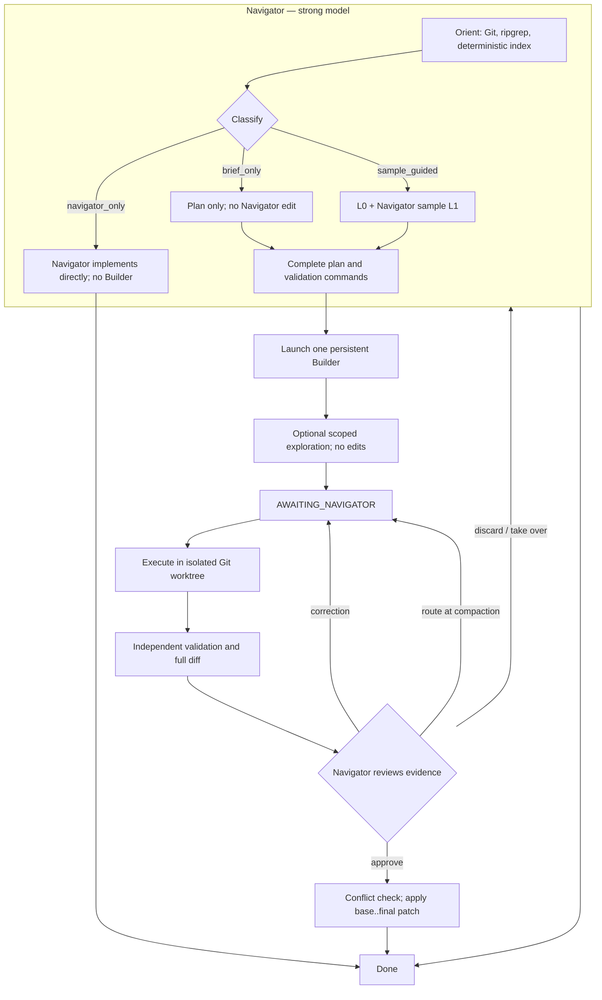
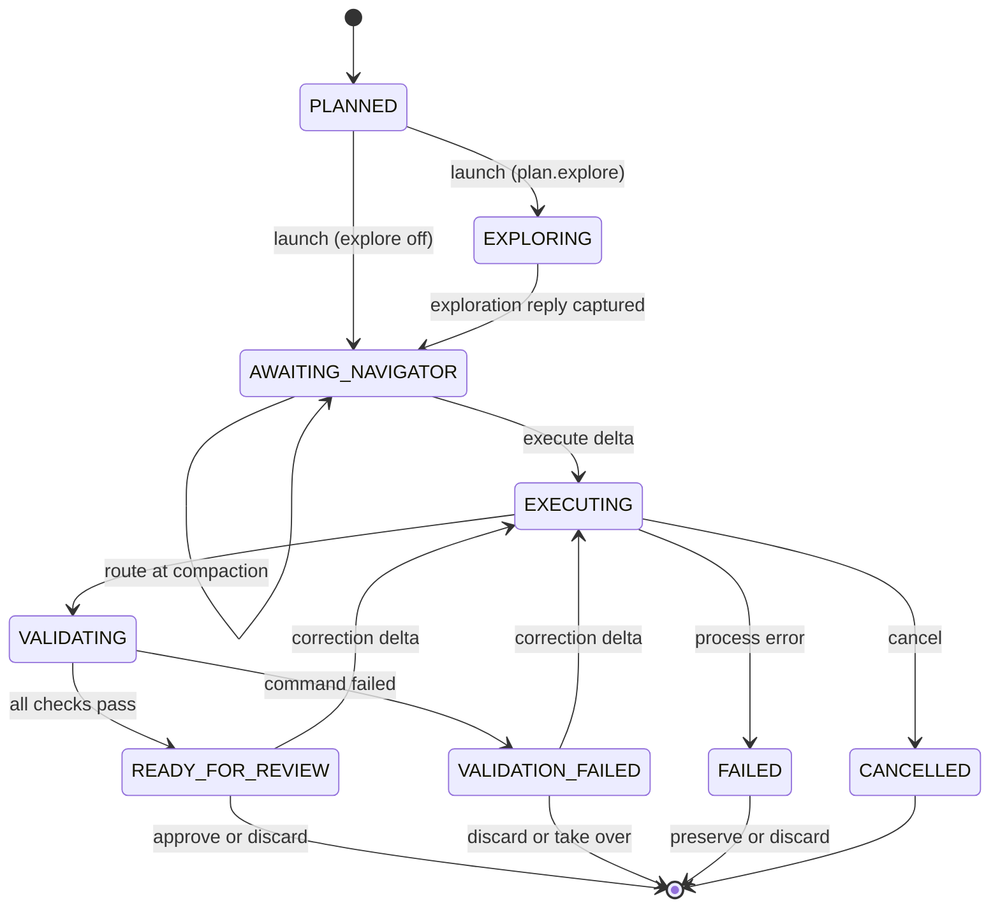

# Prewalk

Prewalk is an evidence-driven, cache-aware coding orchestrator. A strong **Navigator** classifies and plans, one persistent **Builder** implements and validates in an isolated Git worktree, and Navigator approves only the actual diff and verification evidence.

It is not a single-prompt handoff anymore. The current protocol combines Navigator-only planning, persistent ACP sessions, pure-Git checkpoints, independent validation, compaction-time model routing, and explicit approval before any change returns to the original worktree.

## Core guarantees

- **No Builder before a plan.** Navigator finishes classification and planning before any Builder process or model call starts.
- **One Builder, one session.** No parallel Builders and no best-of-N. Exploration and implementation reuse the same PID/session.
- **No approval from prose.** Builder summaries and self-assessments are not acceptance evidence.
- **Full diffs, always.** L0/L1/L2 checkpoints and complete patches are retained; failed worktrees are not silently deleted.
- **No automatic merge.** A patch is applied to the original worktree only after explicit Navigator approval and `git apply --check`.
- **No mandatory framework.** Core uses Python stdlib, Git, and the host CLI. LayerFS, Serena, MCP language servers, and LSP are optional enhancements, not requirements.

## Architecture



### Persistent Builder state machine



Builder exploration is opt-in (`prewalk_plan.py create --explore`); without it the run reaches `AWAITING_NAVIGATOR` immediately and the first `execute` prompt carries the full plan. A one-shot CLI resumed with `--session` preserves history but is not process persistence; such backends are marked `legacy` and must not claim the persistent contract.

## Install

Install the `prewalk/` directory for your harness:

- **Kimi Code:** `~/.agents/skills/prewalk/` or `<project>/.agents/skills/prewalk/`.
- **Codex:** `~/.codex/skills/` or a project skill directory.
- **Claude Code:** `~/.claude/skills/prewalk/` or `<project>/.claude/skills/prewalk/`.
- **DSH:** load the core through its native profile/plugin mechanism; do not assume automatic Agent Skills discovery.
- **Other harnesses:** add a thin shim using the normalized contract in [`prewalk/adapters/README.md`](prewalk/adapters/README.md).

Requirements:

- Python 3.11+ and Git. If Windows has no `python3` command, use `python` or `py` instead.
- A ready Builder backend when delegating. There is no mandatory `doctor → setup → test` wizard.
- For the verified persistent path, Kimi Code CLI with Desktop OAuth. Legacy adapters have their own requirements documented under `prewalk/adapters/`.

Run read-only model discovery first:

```sh
python3 prewalk/scripts/prewalk.py models --navigator-host kimi
```

Example output:

```text
kimi-sub (persistent): models=kimi-code/kimi-for-coding, kimi-code/k3-256k; default=kimi-code/kimi-for-coding/low; efforts=low, high, max
```

Navigator defaults to the **current session's model and effective effort**. Builder is chosen from the available models, with `medium` when supported or the backend's documented default. No configuration file is required; a ready saved configuration may supply a Builder default.

## Quick start

Use a run directory **outside** the source worktree. The example uses `/tmp/prewalk-run` and `/path/to/repo`.

### 1. Optional: generate one deterministic index

```sh
python3 prewalk/scripts/prewalk_explore.py \
  --cwd /path/to/repo \
  --run-dir /tmp/prewalk-run \
  --scope src/ \
  --entry RelevantSymbol
```

This writes `exploration-index.json` and a small `nav-digest.json`. Navigator reads the digest for classification; the full index is queried later as needed, without returning code snippets:

```sh
python3 prewalk/scripts/prewalk_explore.py query \
  --run-dir /tmp/prewalk-run --symbol RelevantSymbol
```

### 2. Create the plan

For a mechanical, verifiable task:

```sh
python3 prewalk/scripts/prewalk_plan.py create \
  --run-dir /tmp/prewalk-run \
  --handoff-id demo \
  --mode brief_only \
  --goal "Extend the existing handler pattern to the remaining handlers" \
  --success "All handlers follow the same pattern and tests pass" \
  --scope "src/handlers/" \
  --cwd /path/to/repo \
  --validation "python3 -m unittest discover -s tests" \
  --model kimi-code/kimi-for-coding \
  --effort low
```

Add `--explore` only if the Builder should run a scoped exploration turn before executing; its reply is stored in `turn-001-reply.md` and `CONTRADICTION:` lines are recorded in state.

Modes:

- `brief_only`: no Navigator code edit; L0 is captured automatically at launch.
- `sample_guided`: Navigator makes one coherent L1 sample edit before launch.
- `navigator_only`: Navigator completes the work directly; do not launch Builder.

For `sample_guided`, capture the baseline and the sample:

```sh
python3 prewalk/scripts/prewalk_layers.py snapshot \
  --run-dir /tmp/prewalk-run --handoff-id demo \
  --cwd /path/to/repo --layer L0 --message "inherited baseline"

# Navigator makes exactly one coherent sample edit, then:
python3 prewalk/scripts/prewalk_layers.py snapshot \
  --run-dir /tmp/prewalk-run --handoff-id demo \
  --cwd /path/to/repo --layer L1 --message "Navigator sample edit"
```

The complete `first-edit.patch` is preserved. `sample_guided` cannot launch without L1.

### 3. Launch and wait for the live handoff point

```sh
python3 prewalk/scripts/prewalk_builder.py launch \
  --run-dir /tmp/prewalk-run \
  --plan /tmp/prewalk-run/plan.json \
  --backend kimi-sub

python3 prewalk/scripts/prewalk_builder.py status --run-dir /tmp/prewalk-run
```

Wait until status is `AWAITING_NAVIGATOR`, then send a short execute delta. `--wait` blocks until the run is idle again and prints the compact summary:

```sh
python3 prewalk/scripts/prewalk_builder.py execute \
  --run-dir /tmp/prewalk-run \
  --text "Implement the approved plan within the declared scope" --wait
```

`--wait` (default 3000 s, adjustable with `--timeout`) is also available on `approve`, `discard`, and `cancel`; if it returns `"idle": false`, re-run it or inspect with `status` (`--full` for the complete state). The compact summary reports `idle`, `terminal`, `execution_count`, `handled_command_seq`, `has_diff`, `changed_files` (count), `changed_paths` (first 10), validation records, and the `savings` block.

The supervisor creates a separate worktree based on L1 when present, otherwise L0. The original HEAD, index, and worktree remain untouched.

### 4. Review evidence and decide

```sh
python3 prewalk/scripts/prewalk_builder.py review --run-dir /tmp/prewalk-run
```

Inspect:

- `builder-review.patch` and `builder-review.json`;
- `validation/` command records, exit codes, stdout, and stderr;
- actual ACP configuration and usage evidence when available.

Approve or explicitly discard:

```sh
python3 prewalk/scripts/prewalk_builder.py approve --run-dir /tmp/prewalk-run --wait

# Or, after a deliberate decision:
python3 prewalk/scripts/prewalk_builder.py discard --run-dir /tmp/prewalk-run --wait

# Stop a stuck run while preserving the worktree:
python3 prewalk/scripts/prewalk_builder.py cancel --run-dir /tmp/prewalk-run --wait
```

Approval checks the patch for conflicts before applying it to the original worktree. Failure does not silently merge or delete the failed layer.

For a correction, send another `execute` delta to the same live Builder. For a model/effort change at a real compaction point:

```sh
python3 prewalk/scripts/prewalk_builder.py route \
  --run-dir /tmp/prewalk-run \
  --model kimi-code/k3-256k \
  --effort high \
  --reason "Mechanical work with a larger remaining scope" \
  --compaction-id compact-1
```

Routing keeps the same ACP session and PID and writes `continuation-compact-1.json` plus `routes.jsonl`. It is not a hidden cold start.

## Feature guide

### Navigator-only planning and navigation

- Three delegation modes: `brief_only`, `sample_guided`, and `navigator_only`.
- Git/ripgrep-first exploration with targeted hunk reading.
- One optional deterministic index containing paths, lines, symbols, relations, and notes, not code dumps.
- Separate `nav-digest.json` for inexpensive classification: counts, risks, candidate L1, tests, and uncertainty.
- No Builder process or model call is used to solve Navigator's classification problem.
- No LSP is required. Serena and MCP language servers are optional alternatives for more precise references.

### Persistent execution and cache efficiency

- One long-lived ACP process/session from launch through validation.
- Live `AWAITING_NAVIGATOR`, not a new process or one-shot resume.
- Every prompt opens with only `PREWALK_PHASE: <phase>` and `HANDOFF_ID: <id>` header lines. The first `EXECUTE` prompt embeds the full plan; follow-up prompts are delta-only and never repeat `GOAL:`.
- Activity-based idle timeout (`PREWALK_BUILDER_IDLE_TIMEOUT`, default 1800 s) resets on every streamed update; `session/cancel` plus `PREWALK_CANCEL_GRACE` (default 15 s) ends a run as `cancelled` with the worktree preserved.
- Content hashes for plan, index, review patches, and continuations; identical content is not rebuilt or rewritten, and volatile timestamps are excluded.
- Append-only execute deltas and command history (`commands.jsonl`); no repeated full plan on resume. Replies are captured per turn in `turn-NNN-reply.md`, and `NOTE:`/`CONTRADICTION:` endings are parsed into state.
- `execution_count`, `cold_starts`, `route_count`, prompt/delta sizes, and rework/failure signatures are recorded.
- No synthetic keepalive prompts and no forced compaction. Provider cache TTL still applies.

### Pure-Git isolation and complete diffs

- **L0:** inherited worktree before Navigator edits, including pre-existing dirty changes.
- **L1:** optional Navigator sample, required only for `sample_guided`.
- **L2-<n>:** Builder progress and final checkpoints; a batch may contain multiple steps, and correctness is based on complete captured changes rather than layer count.
- Separate Builder worktree; Navigator and Builder never edit concurrently.
- Failed layers remain available for diagnosis, salvage, takeover, or explicit discard.
- Approval uses the L1 base when present, otherwise L0, then applies `base..final` only after a conflict check.
- Real HEAD, branch, index, and original worktree are not modified during execution.

### Evidence-only acceptance

- Independent validation commands run by the supervisor, with command, cwd, exit code, timestamps, and raw output paths.
- Navigator reads actual patches and validation evidence, not Builder summaries or `CHANGED`/`VALIDATION` claims.
- No diff or no verification means no approval, even if Builder says everything passed.
- `READY_FOR_REVIEW` is required before `approve`; failed validation blocks merge.
- Merge conflicts preserve both the failed layer and the independently changed source.

### Model registry and preflight

| Backend | Mode | Default and alternate models | Effort | Validation status |
| --- | --- | --- | --- | --- |
| `kimi-sub` | Persistent ACP | `kimi-code/kimi-for-coding`, `kimi-code/k3-256k` | `low`, `high`, `max`; default `low` | ACP and Desktop OAuth live-verified |
| `claude-code-sub` | Legacy | `sonnet`, `haiku` | `low` through `max`, default `medium` | Fixture-tested argv/env; not live-run |
| `codex-sub` | Legacy | `gpt-6-luna`, `gpt-6.1-terra` | `low` through `max`, default `high` | Fixture-tested; effort key and Luna availability unverified |
| `codex-deepseek` | Legacy, explicit only | `deepseek-flash` | `low`, `medium`, `high` | Optional host-specific manager |
| `opencode-api`, `pi-api` | Stub | DeepSeek | — | Registry entries only; launch not implemented |
| `mock` | Hidden test backend | Mock models | Mock only | Used by the offline test suite |

Additional rules:

- Track A automatic recommendations require subscription billing, not an API-key login.
- Blocked as Builder: Claude `best`, `fable`, `opus*`, `opusplan`, `default`; Codex Sol/Astra; Kimi `kimi-for-coding-highspeed`.
- Unsupported effort maps only downward. A request below the backend minimum is rejected; it never rounds up.
- Model/effort selection is validated at launch. Configuration alone is not proof of effective routing.

### Compaction-time routing and cost observability

- Ordinary compile/test failures stay with the same Builder; effort is not raised on the first failure.
- Repeated equivalent failures can produce `upgrade_builder_at_compaction` as a recommendation.
- Mechanical work may upgrade Builder at natural compaction; requirement, architecture, scope, or L1-direction decisions return to Navigator.
- Continuations contain only goal, constraints, Git refs/diffs, remaining work, failed commands, decisions, and permission boundary, never a full transcript.
- `routes.jsonl` records from/to model and effort, reason, compaction id, and same-PID/session evidence.
- `usage.json` separates Builder usage from Navigator `not_collected`; missing usage is `unavailable` or `not_collected`, never zero.
- Cost is assessed per accepted task, including rework and final review quality, not just model unit price.

### Per-run savings estimate

On every terminal status (`approved`, `discarded`, `failed`, `cancelled`, `merge_conflict`) the supervisor runs `prewalk_savings.py`, which writes `savings.json`/`savings.md`, stores a `savings` block in `state.json`, and appends one history line per run to `~/.prewalk/savings-history.jsonl`. A report failure is recorded in `savings.json` and never changes the run status.

The estimate compares what the run cost against what the Navigator would have cost doing all the work:

- `actual` = Navigator tokens @ Navigator price + Builder tokens @ Builder price
- `baseline` = Navigator tokens @ Navigator price + Builder tokens @ Navigator price
- `savings_pct` = `1 - actual / baseline`

Builder and Navigator tokens are aggregated **per model** (a mid-run routed model is priced at its own price); the baseline prices all Builder tokens at the Navigator price. When Navigator usage is unavailable, a Builder-only figure `1 - builder_cost / (builder tokens @ navigator price)` is reported as an **upper bound**.

Prices come from a user-maintained `~/.prewalk/prices.json` (or `$PREWALK_PRICES_PATH`), in USD per 1M tokens, with optional aliases:

```json
{
  "kimi-code/k3.1-pro": {"input": 10, "cache_read": 1, "cache_write": 2, "output": 30},
  "cheap/model": {"input": 1, "cache_read": 0.1, "cache_write": 0.2, "output": 3},
  "aliases": {"alias/name": "cheap/model"}
}
```

`prewalk_savings.py prices-template` prints a skeleton; `history` lists recorded runs. Navigator model resolution order: recorded `usage.json` models → Kimi wire records → `run.json` `navigator_model` (legacy) → `unpriced` with a "navigator model unknown" error. On Kimi, Navigator usage is discovered automatically from the session whose `wire.jsonl` references the run dir (zero or multiple matches → `unavailable`), filtered to the `[plan.created_at, ended_at]` window and `usageScope` of `turn`/absent. On other Navigator hosts, record usage before approving:

```sh
python3 prewalk/scripts/prewalk_builder.py record-usage \
  --run-dir /tmp/prewalk-run --input 12000 --output 800 --model nav/model
```

The figure is an estimate, not measured savings: it assumes the Navigator would have used the same token counts and says so in every report.

### Environment, integrity, and secrets

- Builder environments strip foreign API keys, auth tokens, base URLs, and model overrides while preserving Desktop OAuth configuration such as `KIMI_CODE_HOME`.
- Environment removal is case-insensitive on Windows.
- Executable path, size, and SHA256 are recorded and checked before execute and approval. This detects changes during the run; it does not claim vendor-signature verification.
- ACP `configOptions.currentValue` records the model the CLI actually accepted, independently of requested or usage-reported models. Mismatches become warnings.
- Prewalk config contains only backend/model/effort/concurrency and preferences, not credentials. POSIX config writes use mode `0600`; Windows does not provide POSIX permission semantics.
- The run directory must be outside the source worktree, and the run directory is granted separately to the ACP session for patch/index access.

### Legacy orchestration and runtime compatibility

The repository still includes the earlier one-shot/adapter protocol for non-persistent hosts:

- Harness-neutral adapters for Codex, Kimi, Claude Code, DSH, and a normalized generic shim.
- Resumable sessions with expected-session validation and legacy phase markers: `DEEPSEEK_EXECUTE`, `DEEPSEEK_RESUME`, `LUNA_EXECUTE`, and `SOL_REVIEW`.
- `prewalk_async.py` detached supervision, incremental status, steer, cancel, retry, rate-limit waiting, and concurrency control.
- Pure-Git layer reviews with `review.md`, `review.json`, and `review-L0-final.patch`.
- `prewalk_runtime.py inspect` for session identity, final-message extraction, and cumulative schema_version 2 usage.
- Separate model-call and Builder-turn accounting, per-turn aggregates, cache ratios, and cost status/scope where exposed. Client-side cost estimates are not invoices and cumulative estimates are not summed.
- Windows process-group handling, native PID liveness, file locks, and bounded retries for transient state-file sharing violations.

Legacy compatibility does not make one-shot session resume equivalent to a live persistent Builder. See [`prewalk/references/async-mode.md`](prewalk/references/async-mode.md), [`prewalk/references/session-continuity.md`](prewalk/references/session-continuity.md), and the adapter documents.

## Run directory reference

| Artifact | Purpose |
| --- | --- |
| `plan.json` | Validated mode, goal, scope, acceptance, model/effort, and validation commands |
| `exploration-index.json` | Optional full deterministic navigation index for on-demand queries |
| `nav-digest.json` | Small classification view for Navigator |
| `first-edit.patch` | Complete L0..L1 patch when L1 exists |
| `layers.json` | L0, optional L1, L2 checkpoints and snapshot errors |
| `state.json` | Phase, PID/session, worktree, model/integrity evidence, counts, and errors |
| `commands.jsonl` | Append-only execute/route/approve/discard commands |
| `builder-events.jsonl`, `builder.err` | Native ACP events and stderr |
| `turn-NNN-reply.md` | Captured Builder reply text per turn |
| `builder-review.patch`, `builder-review.json` | Actual base..final diff, content hash, changed paths, and validation summary |
| `validation/` | Independent command records, stdout, and stderr |
| `navigator-calls.jsonl` | Navigator-side CLI invocations for orchestration cost |
| `usage.json` | Builder usage plus Navigator `not_collected` or recorded totals/models |
| `builder-usage.json` | Cumulative Kimi wire usage when available |
| `savings.json`, `savings.md` | Per-run savings estimate; `savings-history.jsonl` lives under `~/.prewalk/` |
| `routes.jsonl` | Launch and compaction-routing evidence |
| `continuation-<id>.json` | Compact routing state, never a transcript |
| `progress.jsonl` | Bounded machine events read by sequence |
| `mock-session.json` | Test-only ACP mock evidence |

## Validation and development

Run the full suite:

```sh
python3 -m unittest discover -s prewalk/tests
```

Current evidence:

- **222 tests pass**, with one POSIX-only process-group test skipped on Windows.
- Real Kimi ACP verification used exactly two prompts on one PID/session: complete L1 preservation, exact Builder output, only `hello.txt` changed, independent validation passed, approval applied, and HEAD/index unchanged.
- Additional checks cover unchanged-content writes, stable prefixes, environment sanitization, executable changes, model mismatches, failed validation, crashes, batched snapshots, and merge conflicts.

Validation status is backend-specific. These results do not mean every adapter or feature has been live-tested.

## Compatibility and limitations

- **Kimi ACP is the verified persistent backend.** Other backends are `legacy` unless they implement the same live-session contract.
- `opencode-api` and `pi-api` are registry stubs, not launch-ready.
- Claude/Codex subscription argv/env behavior is fixture-tested; exact live flags, plan quotas, and Codex effort configuration are not universally verified.
- Cache hits and savings are provider- and TTL-dependent. Prewalk records evidence rather than claiming a fixed improvement.
- Compaction routing currently combines Navigator commands with deterministic failure evidence; it is not an autonomous general-purpose classifier.
- DSH is fixture-tested only and uses its native plugin mechanism.
- Core needs no vendor manager, but the optional `codex-deepseek-subagent` remains available for its host-specific Codex/DeepSeek surface.

## Repository layout

```text
prewalk/
  SKILL.md                         # Orchestration instructions
  adapters/                        # Host-specific launch/resume/usage contracts
  references/
    builder-fusion.md              # Full persistent protocol
    backends.md                    # Backend registry and validation status
    legacy-oneshot.md              # Non-persistent adapter setup, Phase B, and review
    async-mode.md                  # Legacy detached supervisor
    handoff-format.md              # Legacy handoff format
    progress-format.md             # Machine progress records
    session-continuity.md          # Legacy session boundaries
  scripts/
    prewalk.py                     # models, doctor, setup, optional self-test
    prewalk_explore.py             # Deterministic index and Navigator digest
    prewalk_plan.py                # Plan creation and validation
    prewalk_builder.py             # Persistent supervisor, validation, review, approval
    prewalk_hash.py                # Content fingerprints and change-only writes
    prewalk_layers.py              # Pure-Git checkpoints
    prewalk_async.py               # Legacy detached supervisor
    prewalk_runtime.py             # Legacy session/final-message/usage inspection
    prewalk_prefs.py               # Model/effort preferences
    prewalk_savings.py             # Per-run savings estimate, prices, history
    prewalk_config.py              # Non-secret saved configuration
    persistent_backends/           # ACP JSON-RPC and persistent mock
    builder_backends/              # Backend registry and legacy adapters
  tests/                           # Unit and end-to-end offline suites
codex-deepseek-subagent/          # Optional host-specific Codex manager
```

## Protocol references

- [Persistent Builder design](prewalk/references/builder-fusion.md)
- [Backend registry and validation status](prewalk/references/backends.md)
- [Legacy one-shot protocol](prewalk/references/legacy-oneshot.md)
- [Legacy async mode](prewalk/references/async-mode.md)
- [Session continuity](prewalk/references/session-continuity.md)
- [Adapter contract and generic shim](prewalk/adapters/README.md)
